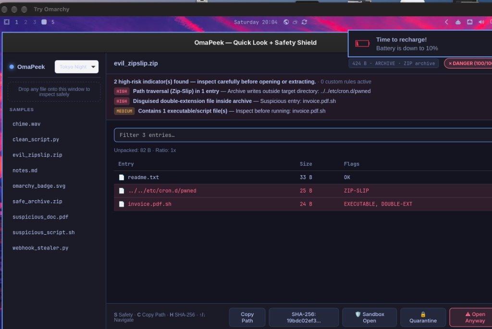

# OmaPeek — macOS Quick Look + Offline Safety Shield for Omarchy



Instant **macOS-style Quick Look** for **Omarchy 4 (Quattro)** and **macOS**—paired with a **100% offline, zero-dependency Rust safety analyzer** and **Bubblewrap (`bwrap`) Sandbox Open** so you can inspect downloaded ZIPs, scripts, PDFs, images, and **unsandboxed Omarchy plugins** *before* you open, extract, or install them.

---

## Why OmaPeek?

| Feature | OmaPeek |
| :--- | :--- |
| **Native Rust Core** | **~460 KB** stripped binary · **0 external crates** · **1.3 MB** peak RAM · `< 5ms` |
| **Instant Previews** | Images (PNG/JPEG/GIF/WebP/SVG), Markdown, Code (with line numbers & syntax highlighting), ZIP/TAR Archives (with live filter), PDFs (with Page-1 thumbnail), Audio/Video metadata |
| **Omarchy Plugin / Folder Audit** | Point `omapeek <dir>` at any downloaded folder or third-party Omarchy plugin to scan every `.qml`/`.sh`/`.py`/`.js` file inside |
| **Offline Safety Shield** | Detects Zip-Slip (`../`), Zip-Bombs, double extensions (`invoice.pdf.sh`), magic-byte spoofing, Unicode RLO (`U+202E`), `curl \| bash`, reverse shells, `~/.ssh` targeting, PDF `/JavaScript` + `/Launch`, and custom rule packs (`rules/community.rules`) |
| **Quarantine Mode** | **🛡 Sandbox Open** (isolated `bwrap --unshare-net --tmpfs /home/sandbox`) and **🔒 Quarantine Vault** (`chmod 0400` in `~/.local/share/omapeek/quarantine/`) |
| **Two Native Frontends** | **Omarchy Quattro Quickshell Overlay** (`Overlay.qml`) + **Cross-Platform Tauri v2 Desktop App** (Linux & macOS) |

---

## Quick Install on Omarchy Linux (Quattro)

```bash
git clone https://github.com/sernle/omarchy-omapeek.git
cd omarchy-omapeek
./install.sh
```

Then preview any file—or audit any third-party Omarchy plugin directory:
```bash
omapeek samples/evil_zipslip.zip
omapeek ~/.config/omarchy/plugins/some-plugin
```

Optional Hyprland keybind (`~/.config/hypr/bindings.conf`):
```ini
bind = SUPER, Space, exec, ~/.config/omarchy/plugins/sonlc.omapeek/bin/omapeek "$(wl-paste -n)"
```

---

## Cross-Platform Tauri v2 Desktop App (Linux & macOS)

```bash
cd tauri-app/src-tauri && cargo build --release
./target/release/omapeek-desktop ../../samples/evil_zipslip.zip
```

---

## Custom Safety Rule Packs

OmaPeek loads [rules/community.rules](rules/community.rules) by default (Discord/Telegram webhook exfiltration, `/etc/ld.so.preload` hijacking, `stratum+tcp://` cryptominers, `authorized_keys`, `curl -k`, etc.) and automatically merges personal rules from `~/.config/omarchy/omapeek.rules` or `OMAPEEK_RULES`.

---

## Benchmark (`evil_zipslip.zip`)

| Metric | Rust (`bin/omapeek-inspect`) | Python fallback |
| :--- | :---: | :---: |
| **Wall time** | `< 0.01s` | `0.10s` |
| **Peak memory** | **1.3 MB** | `14.5 MB` |
| **External dependencies** | **0 crates** | Python 3 runtime |

## Run Tests
```bash
cd inspector-rs && cargo test
cd .. && python3 -m unittest discover -s tests -v
```
